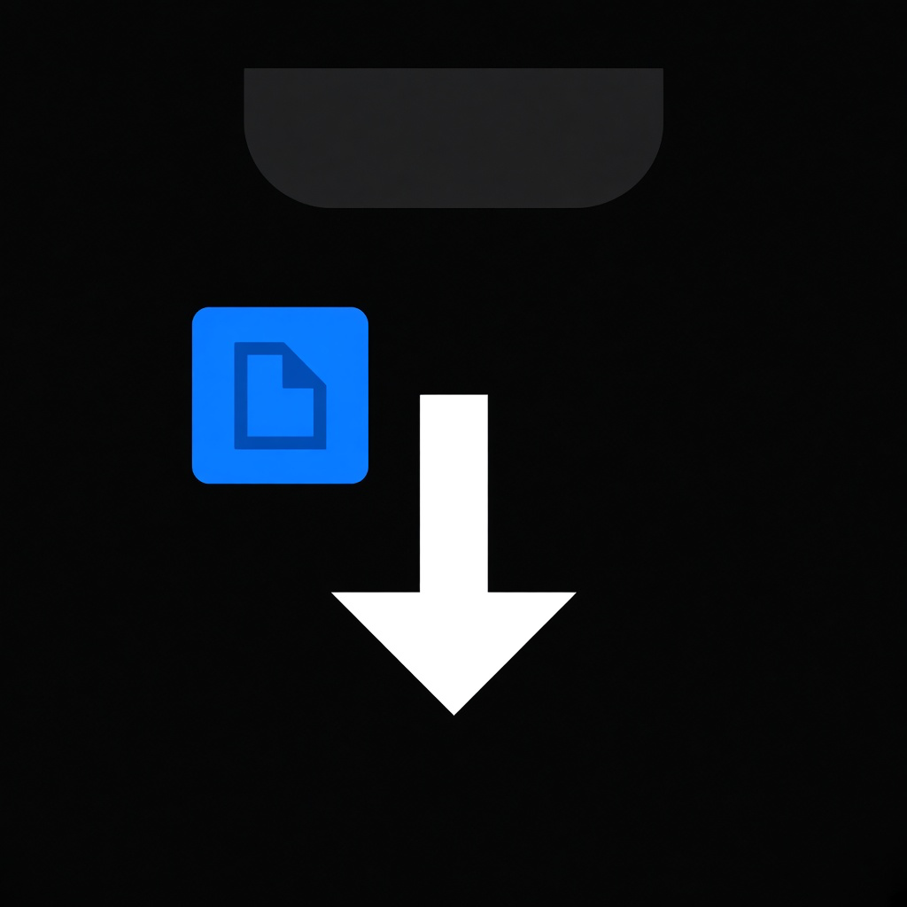
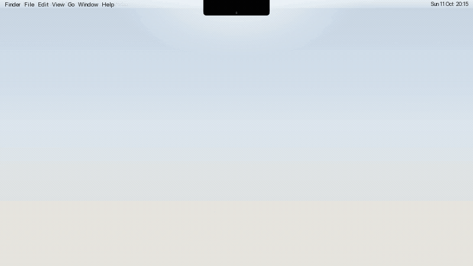

#  Notch Downloads

[](https://github.com/mslmyilmaz5/notch-downloads/stargazers)
[](https://github.com/mslmyilmaz5/notch-downloads/releases/latest)
[](LICENSE)

A small macOS app that hangs under the MacBook notch and shows your **last 5 downloads**.



## Install

### Homebrew

```sh
brew tap mslmyilmaz5/notch-downloads https://github.com/mslmyilmaz5/notch-downloads
brew trust mslmyilmaz5/notch-downloads
brew install --cask notch-downloads
```

Homebrew will not load a cask from a third-party tap until that tap is trusted.

Apple Silicon only (arm64), macOS 13 Ventura or later. The cask is pinned to the current release (v1.2.1) and its SHA-256. A new GitHub release does not reach Homebrew until `version` and `sha256` in [`Casks/notch-downloads.rb`](Casks/notch-downloads.rb) are updated. After install, the cask clears the download quarantine flag (`xattr -cr`) so Gatekeeper does not report the unsigned app as damaged.

On first launch, macOS asks for access to your Downloads folder and to your screenshot folder (Desktop by default). That folder is watched from the start, not only when **Show Screenshots Instantly** is on.

Uninstall:

```sh
brew uninstall --cask notch-downloads
```

### Direct download

Prebuilt app: **[latest release](https://github.com/mslmyilmaz5/notch-downloads/releases/latest)**

| File | Link |
| --- | --- |
| DMG | [NotchDownloads.dmg](https://github.com/mslmyilmaz5/notch-downloads/releases/latest/download/NotchDownloads.dmg) |
| ZIP | [NotchDownloads.zip](https://github.com/mslmyilmaz5/notch-downloads/releases/latest/download/NotchDownloads.zip) |

Open the DMG or ZIP and drag the app to `/Applications`. The build is not notarized.

- On macOS 13 and 14, **right-click → Open** once is usually enough.
- On macOS 15 Sequoia and later, open the app once, then go to **System Settings → Privacy & Security** and click **Open Anyway**.

If macOS says the app is damaged:

```sh
xattr -cr /Applications/NotchDownloads.app
```

Then allow access to your Downloads folder and your screenshot folder. The Homebrew install above clears that quarantine flag for you.

[Demo video (MP4)](docs/demo.mp4)

## Features

- **A thin chin under the notch.** Idle, it reads as part of the notch. Hover highlights it; click expands the list.
- **A short preview** when a new file arrives.
- **The last 5 files**, newest first, with their real icons.
- **Drag and drop.** Drag a row — or the new-file preview, without opening the list — into Finder, Terminal, or any other app.
- **Quick actions** on hover: Show in Finder, Copy, Share, Move to Trash. The same actions are in the right-click menu.
- **Hides partial downloads.** `.download`, `.crdownload`, `.part`, and similar files stay out of the list until the download finishes.
- **Screenshots.** The macOS screenshot folder (Desktop by default) is watched from the start, and only screenshot and screen-recording files from that folder are added. **Show Screenshots Instantly** only turns off the system’s floating thumbnail, so a new capture shows up in the notch the moment you take it.
- **English interface.** Menus, the panel, and permission copy are in English.
- **Menu bar icon** to show downloads, turn on instant screenshots, launch at login, open the Downloads folder, or quit. Click a row to open the file. The right-click menu also has Open.
- On displays without a notch (external monitors), the panel sits centered under the menu bar.

## Requirements

- macOS 13 Ventura or later
- Apple Silicon (M1 or later). The release build is `arm64` only
- A Swift toolchain to build from source (Xcode Command Line Tools are enough): `xcode-select --install`

## Run from source

```sh
make run
```

That builds the app, writes `dist/NotchDownloads.app`, and launches it.

The first time, macOS asks to let Notch Downloads read your Downloads folder. Choose **Allow**. If access was denied, use **Open System Settings** inside the panel.

### Skip the permission prompt while developing

The app is ad-hoc signed, so macOS can forget the folder grant on every rebuild. While developing, run it from the terminal instead:

```sh
make dev
```

It inherits the Downloads permission your terminal (Terminal or iTerm) already has, and does not ask again on each build.

## Install from source

```sh
make install   # copies the app to /Applications
```

Then turn on **Launch at Login** from the menu bar icon.

## Uninstall a source install

```sh
make uninstall
```

## Layout

| File | Role |
| --- | --- |
| `DownloadsMonitor.swift` | Watches `~/Downloads` with a `DispatchSource` (vnode) and keeps the last 5 files |
| `ScreenshotSettings.swift` | Screenshot folder and the `show-thumbnail` setting (`com.apple.screencapture`) |
| `NotchGeometry.swift` | Notch frame in screen coordinates (`auxiliaryTopLeftArea` / `safeAreaInsets`) |
| `NotchViewModel.swift` | UI state (chin / preview / list) and file actions |
| `NotchPanelController.swift` | Non-activating `NSPanel` parked under the notch, plus the animations |
| `Views/` | SwiftUI views (list, row, preview) |
| `AppDelegate.swift` | Menu bar icon and launch at login (`SMAppService`) |

Folder access is not sandboxed. On first launch, macOS asks for Downloads and for the screenshot folder (Desktop by default).

## License

[MIT](LICENSE)
